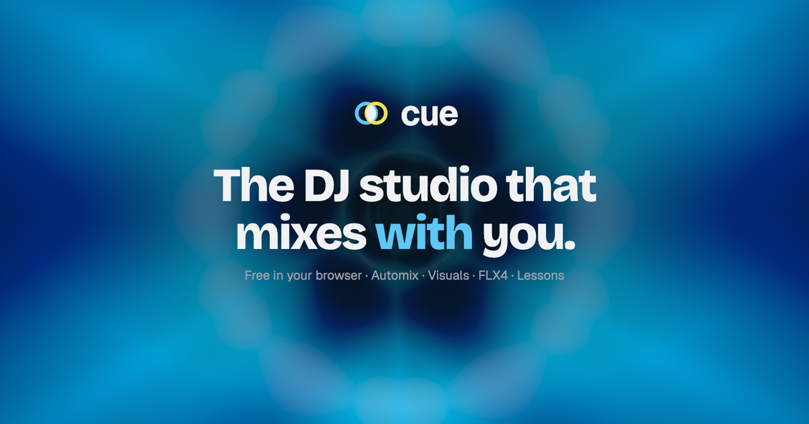

# Cue



**A free DJ studio in your browser, with an Automix that explains every transition and a coach that teaches you to mix.** No install and no account. Your music stays on your computer.

- **Studio:** `/app`
- **How Cue compares with rekordbox, Serato, Traktor, djay and VirtualDJ:** `/compare`
- **Automix mixing an 18-minute set on its own:** `/automix-test`

Cue is in public beta (v1.0.0-beta.1). It runs best in desktop Chrome or Edge.

## What it does

### Studio
- **Decks and mixer:** two decks with sync, key lock and key shift, 8 hot cues, loops and rolls, beat jump, slip and quantize. The mixer has trim, 3-band EQ, a filter, faders, an equal-power crossfader and a master limiter.
- **Effects:** beat-synced echo, reverb, filter and roll pads.
- **Stems:** vocals, drums, bass and melody on each deck, with mute and solo, once a track's stems are prepared.
- **Jog scratching:** a touched record brakes under your hand, fast scratches stay clean, and the record spins back up when you let go.
- **Waveforms and layouts:** parallel waveforms with phrase and cue markers, Mixer, Parallel and Library layouts, and a full-screen visualizer with 22 scenes.
- **Recording:** mix recording with a timestamped tracklist and CUE sheet.

### Automix
- **Next track:** picks it from your current playlist or folder by tempo, key, energy and where the set is going. It looks 2–3 tracks ahead.
- **Routines:** chooses from 25, including bass swap, long blend, drop swap, double drop, fake drop, loop, echo out and five stem routines. Each choice shows a score and the reasons for it.
- **Auto-FX:** echo catches, filter builds, risers and rolls on the beat grid, with a Subtle or Expressive budget.
- **Tempo and key:** tempo journeys between tracks, and keys judged as you'll hear them after the tempo change.
- **Set mode:** follows an energy arc (warm-up, build, peak, close) over 15 minutes to 2 hours. It shows the curve and the upcoming tracks you can promote or skip.
- **Preview:** hear any planned transition in your headphones before it plays.

### Analysis, on your device
- **Beats and downbeats:** found by the [Beat This!](https://github.com/CPJKU/beat_this) model (MIT), with a signal-processing fallback.
- **Key:** tuning-corrected, with a key for each section.
- **Sections:** intro, build, drop, breakdown and outro, landing on the right bar.
- **Stems:** separated by [htdemucs](https://github.com/facebookresearch/demucs) (MIT) in the browser, on the GPU when there is one. Stems are opt-in per track and stored compressed.
- **Your fixes:** set the key, beat 1 or sections when analysis is wrong. Your fixes always win, and Automix trusts them.

### Learning
- **Lessons:** 28 transition techniques and an 18-genre guide, practised on real decks in `/learn`.
- **Coach:** a live coach shows exit and entry zones, bar countdowns and the next move.
- **Controller:** Pioneer DDJ-FLX4 support, with all pad modes, Beat FX, jog scratching, LED feedback and a practice report after each mix.

## Privacy

Audio never leaves the device. Imported files, analysis, stems, cues and settings live in the browser's IndexedDB. The analysis and stem models are downloaded once and run locally.

The landing page shows a visitor count from [Abacus](https://abacus.jasoncameron.dev), a free counting service. Each browser is counted once (remembered in `localStorage`), and no personal data is sent.

## Run it locally

Requires Node 22+ and pnpm.

```sh
pnpm install
pnpm dev
```

Then open <http://localhost:3000> for the landing page, or <http://localhost:3000/app> for the studio.

```sh
pnpm typecheck
pnpm lint
pnpm test             # unit and engine tests (Vitest)
pnpm bench:analysis   # beat, key and section accuracy bench, see docs/ANALYSIS_BENCH.md
pnpm build
```

## Deploy

Cue is a [TanStack Start](https://tanstack.com/start) app with server rendering, deployed on Vercel. `vercel.json` selects the TanStack Start framework, and the Nitro plugin builds Vercel's output. Import the repository with the root directory `.` and no build overrides.

Link previews on X, Slack and iMessage use `public/og.jpg`, which needs an absolute URL. On Vercel the production domain is picked up automatically. Elsewhere, set `SITE_URL` (for example `https://cue.example.com`) when building.

To check a Vercel build locally:

```sh
NITRO_PRESET=vercel pnpm build
node scripts/verify-vercel-build.mjs
```

## How it's built

- **App:** React 19, TanStack Start and Router, Tailwind CSS 4, and shadcn components on Base UI.
- **Audio:** Web Audio with AudioWorklets for scratching and key lock (SoundTouch). Automation is scheduled on the audio clock.
- **Models:** onnxruntime-web, with WebGPU first and a WebAssembly fallback, in Web Workers.
- **Storage:** IndexedDB. Stems are stored as Opus via WebCodecs.

### Where to look

| Path | What it does |
|---|---|
| `src/lib/dj/engine.ts` | Audio graph, transport, sync, key lock, scratching, recording and Automix execution |
| `src/lib/dj/planner.ts` | Transition routines and how they are scored and explained |
| `src/lib/dj/automix-session.ts` | Track picking, lookahead and Set mode |
| `src/lib/dj/analyze.ts`, `rhythm.ts`, `key.ts`, `beat-model.ts` | Beat, key and section analysis |
| `src/lib/dj/demucs.ts`, `stems.worker.ts`, `stem-matrix.ts` | Stem separation and stem playback |
| `src/lib/dj/loudness.ts` | Section loudness matching and overlap headroom |
| `src/components/dj/` | Studio UI |
| `src/routes/` | Landing (`/`), studio (`/app`), Learn, Compare, Automix test and Roadmap |

## Known limits

- **Two decks only:** four-deck mixing and MIDI learn are on the roadmap; the DDJ-FLX4 is the only mapped controller.
- **Stems are prepared ahead:** about a minute for a 2½-minute track on a desktop GPU. They aren't separated live as a track loads. A deck with stems uses several times the memory of one without.
- **Key-lock sound:** key lock is accurate in timing (its delay is compensated), but long held chords can sound slightly phasey next to élastique-class stretching.
- **Analysis:** beat, key and section accuracy is measured on synthetic and Creative Commons test tracks. A real-music benchmark is still to run.
- **Storage:** the browser can evict its storage. Request persistent storage in Settings, and keep your originals backed up.

## Credits and licenses

Bundled demo music is by Kevin MacLeod ([incompetech.com](https://incompetech.com/music/royalty-free/)), licensed [CC BY 3.0](https://creativecommons.org/licenses/by/3.0/); details are in [docs/AUDIO_CREDITS.md](docs/AUDIO_CREDITS.md). Third-party code and model licenses (onnxruntime-web, Beat This!, htdemucs, SoundTouch and others) are listed in [docs/THIRD_PARTY.md](docs/THIRD_PARTY.md).

rekordbox, Serato, Traktor, djay, VirtualDJ and Beatport are trademarks of their owners. Cue is not affiliated with them.

## More docs

- [Automix plan](docs/AUTOMIX_PLAN.md)
- [Analysis bench results](docs/ANALYSIS_BENCH.md)
- [DDJ-FLX4 controller](docs/FLX4_CONTROLLER.md)
- [Verification notes](docs/VERIFICATION.md)
- [Brand](docs/BRAND.md)
